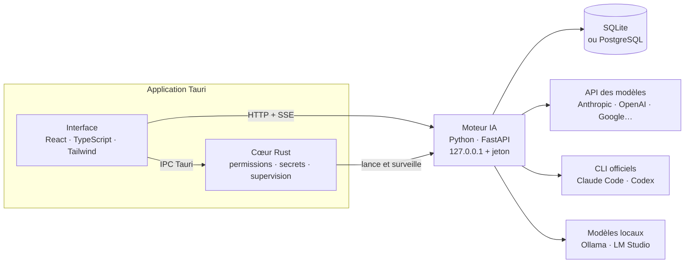
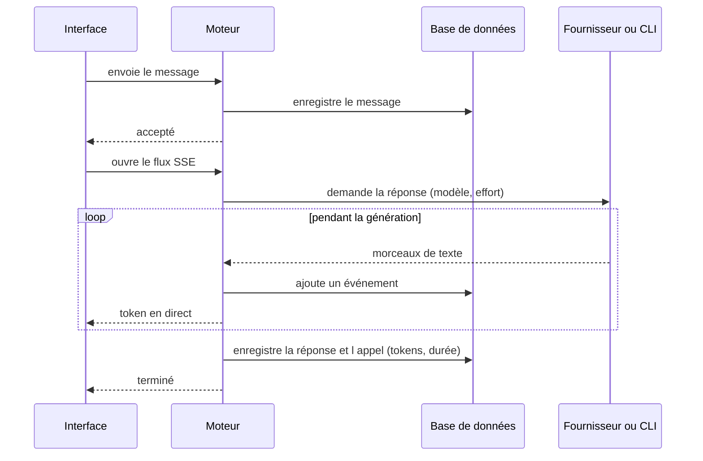
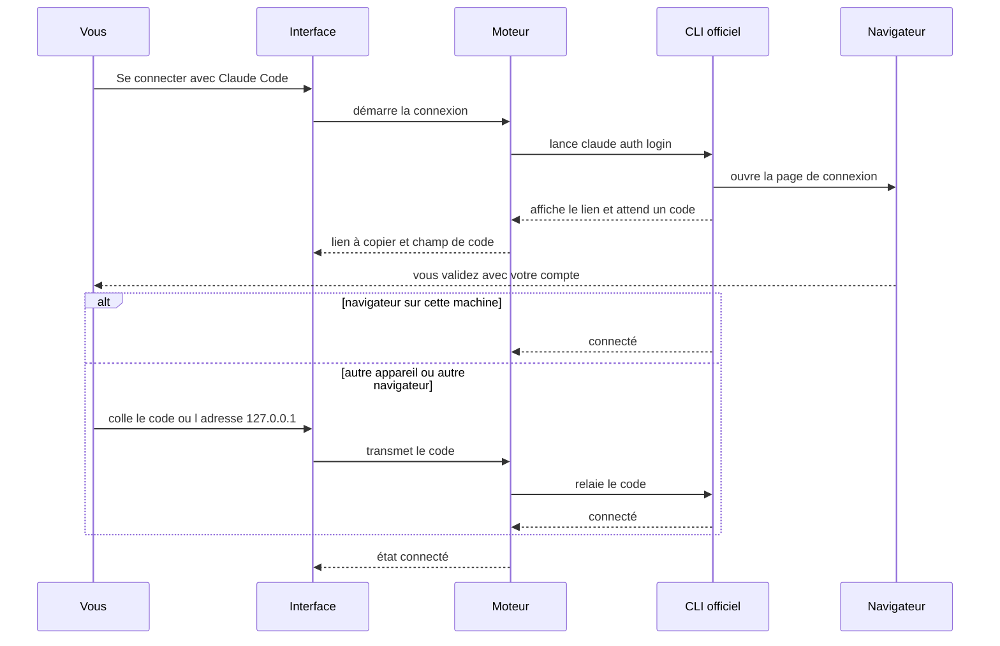

<div align="center">


# Elysium

### Votre équipe de développement, propulsée par l'IA.

**Décrivez une idée. Regardez-la devenir un logiciel.**

[](https://github.com/Zafery-Cosmos/elysium/releases)
[](https://github.com/Zafery-Cosmos/elysium/actions/workflows/ci.yml)
[](LICENSE)


Elysium n'est pas un chatbot. Ce n'est pas un simple générateur de code.
C'est un **environnement de développement intelligent** où une équipe d'agents IA
spécialisés — chef de projet, architecte, développeurs, ingénieur base de données,
DevOps, sécurité, QA — collabore pour transformer votre idée en application
fonctionnelle, pendant que **vous gardez le contrôle à chaque étape**.

> Un chatbot répond. Un assistant code. **Une équipe construit.**

</div>

---

## Sommaire

- [Pourquoi Elysium](#pourquoi-elysium)
- [Fonctionnalités](#fonctionnalités)
- [Comment ça marche](#comment-ça-marche)
- [Se connecter à une IA](#se-connecter-à-une-ia)
- [Données et base de données](#données-et-base-de-données)
- [Sécurité et vie privée](#sécurité-et-vie-privée)
- [Stack technique](#stack-technique)
- [Structure du dépôt](#structure-du-dépôt)
- [Installer Elysium](#installer-elysium)
- [Développer](#développer)
- [Publier une version](#publier-une-version)
- [État du projet et feuille de route](#état-du-projet-et-feuille-de-route)
- [Questions fréquentes](#questions-fréquentes)
- [Documentation](#documentation) · [Licence](#licence)

---

## Pourquoi Elysium

Vous avez une idée. Vous n'avez pas forcément les compétences techniques, ou pas
le temps. Vous ouvrez Elysium, vous écrivez une phrase :

> « Je veux une application pour réserver des restaurants. »

Elysium comprend votre intention, vous pose les bonnes questions (et seulement
celles-là), rédige un cahier des charges, propose une architecture et un plan de
tâches — en vous montrant chaque décision **avant** de l'appliquer.

Trois idées guident le produit :

1. **Une équipe, pas un oracle.** Des rôles explicites qui se répartissent le travail.
2. **Vous décidez.** Refus par défaut : aucun agent n'agit sans autorisation.
3. **Pas de dépendance imposée.** Vos propres comptes Claude ou ChatGPT, des clés
   API, ou des modèles 100 % locaux — au choix, et on peut en changer à tout moment.

---

## Fonctionnalités

### 💬 Conversation guidée, du langage naturel au plan

- **Trois modes de chat** : **Discuter** (cadrer l'idée), **Plan** (produire un plan
  et un graphe de tâches), **Éditer** (réviser la dernière réponse).
- **Questions adaptatives.** Le chef de projet tient une liste de critères
  (objectif, fonctionnalités, utilisateurs, données, plateforme, intégrations,
  contraintes, exclusions) et ne pose que les questions utiles, une à la fois. Vous
  pouvez répondre « décide pour moi » : l'élément est marqué comme *supposé* et
  reste visible.
- **Indicateur de compréhension.** Un pourcentage pondéré de couverture de cette
  liste. C'est une heuristique de complétude, **pas une probabilité** — et il n'atteint
  jamais 100 % avec des suppositions seules.
- **Mode Simple ou Expert.** *Simple* : un seul modèle travaille en solo. *Expert* :
  le chef de projet coordonne toute l'équipe.

### 🧠 Une équipe de huit agents

| Agent | Rôle |
|---|---|
| **Chef de projet** | Recueille les besoins, rédige la spec, construit et met à jour le graphe de tâches, arbitre |
| **Architecte** | Conception, choix techniques, découpage en modules |
| **Frontend** · **Backend** · **Base de données** | Réalisation de leur périmètre |
| **DevOps** | Build, CI, Docker, environnement |
| **Sécurité** | Relit les changements, signale secrets et risques |
| **QA** | Plans de test et exécution |

Chaque agent a un **profil de permissions** (fichiers : aucun / lecture / lecture-écriture ;
shell ; réseau) que vous modifiez dans *Réglages › Agents*. Vous pouvez aussi créer des
agents personnalisés et désactiver ceux dont vous n'avez pas besoin.

L'exécution est **pilotée par un graphe de tâches** persistant (tableau Kanban) : un
agent n'est activé que lorsque les dépendances de sa tâche sont satisfaites. En mode
Expert *Analyse*, l'équipe parcourt le graphe dans l'ordre et produit un résumé écrit par
tâche, **sans toucher à vos fichiers**.

### 🔑 Connexion avec votre propre compte (Claude Code · Codex)

Pas de clé API à créer : au premier lancement, **« Se connecter avec Claude Code »** ou
**« Se connecter avec Codex »**. Elysium pilote le CLI officiel installé sur votre
machine, connecté à *votre* abonnement. Voir [Se connecter à une IA](#se-connecter-à-une-ia).

### 🌐 Multi-modèles et routage

- Fournisseurs : **Anthropic**, **OpenAI**, **Google (Gemini)**, **xAI**, **Mistral**,
  **DeepSeek**, **OpenRouter**, modèles **locaux** (**Ollama**, **LM Studio**) et tout
  serveur compatible OpenAI que vous ajoutez.
- **Sélecteur de modèle** avec palier de coût (`$` → `$$$$`), date de sortie, fenêtre de
  contexte et **niveau d'effort** (faible / moyen / élevé).
- **Routage automatique** par classe de tâche (raisonnement, code, tâches légères) ou
  **modèle imposé** dans *Réglages › IA*.
- **Cache de prompt** (API Anthropic) pour ne pas refacturer le même contexte à chaque tour.

### 📊 Administration

Une page dédiée (`Administration`) pour savoir **ce qui se passe et ce qui reste** :

- **Connexions IA** : connecté ou non pour chaque abonnement, modèle par défaut.
- **Quota de l'abonnement** : jauges des fenêtres de 5 heures et de 7 jours (Claude Code)
  avec l'heure de remise à zéro.
- **Consommation** : appels, tokens envoyés/reçus, erreurs, équivalent API en dollars,
  graphique **par jour et par IA**, tableaux **par IA, par modèle et par agent**.
- **Fiabilité** : taux d'erreur, latence moyenne, dernières erreurs.
- **Actions demandées par les agents** et état du moteur (version, durée de marche).

Chaque appel est enregistré dans la base de données locale (table `usage`) : l'historique
survit au redémarrage et à la suppression d'un projet.

### 🔌 Marketplace MCP

Un catalogue de serveurs MCP (GitHub, Docker, Postgres, Slack…) avec formulaire de
configuration ; les secrets vont dans le trousseau du système, jamais dans la base.
*La configuration est enregistrée ; l'exécution des outils MCP par les agents arrive avec
le courtier de permissions complet.*

### ⚙️ Des réglages qui font vraiment quelque chose

Une règle du projet : **un réglage n'existe que s'il a un effet réel.** Aujourd'hui :
langue de l'interface et des réponses de l'IA, thème clair / sombre / automatique,
densité, taille du texte, animations, confirmation avant suppression, reprise de la
dernière conversation, modèle et effort par défaut, routage, streaming, plafond de
tokens, délai et nouvelles tentatives, cache de prompt, niveau de logs, **masquage des
secrets avant envoi** et **mode 100 % local**.

### 🎨 Interface

Thème monochrome épuré, interface en **français, anglais, espagnol**, navigation au
clavier, respect de `prefers-reduced-motion`, bascule clair/sombre en direct.

### 🔄 Mises à jour automatiques

L'application vérifie les nouvelles versions publiées sur GitHub, vérifie leur **signature**
puis propose de les installer en un clic.

---

## Comment ça marche

### Les trois couches



- **Interface (React).** Elle n'exécute rien de sensible : elle affiche et envoie des
  demandes. L'état est géré par des stores Zustand, le routage par `HashRouter`
  (identique en mode navigateur et dans la fenêtre Tauri).
- **Cœur Rust (Tauri).** Seul à toucher au système : fenêtre, trousseau de secrets,
  accès fichiers à périmètre limité, journal d'audit. **Il lance le moteur** : génère un
  jeton de session aléatoire (32 octets), choisit un port libre, démarre le moteur,
  attend que `/health` réponde, puis le **surveille** (redémarrage avec délai croissant
  s'il tombe). À la fermeture, il arrête toute l'arborescence de processus du moteur.
- **Moteur IA (Python/FastAPI).** Il héberge les agents, les fournisseurs de modèles, la
  base de données et le routage. Il n'écoute que sur `127.0.0.1` et **refuse toute
  requête sans le jeton** reçu au démarrage.

En production, le moteur est embarqué sous forme d'un exécutable unique (**PyInstaller**)
lancé par l'application, sans fenêtre console.

### Le trajet d'un message



Tout passe par un **journal d'événements en ajout seul** : l'interface affiche les
décisions et résumés issus de ce journal, pas la sortie brute des modèles. Un
redémarrage reprend depuis l'état du graphe de tâches et du journal — rien ne vit
uniquement en mémoire.

### Un contrat commun pour tous les modèles

Chaque fournisseur (Anthropic, compatibles OpenAI, CLI Claude Code, CLI Codex) implémente
la même interface `ModelProvider` et renvoie les mêmes morceaux normalisés (`token`,
`tool_call`, `done`). Les agents et le routage ne connaissent donc **aucun format propre
à un fournisseur** : ajouter un fournisseur ne touche pas au reste du code.

---

## Se connecter à une IA

Trois façons, combinables :

| Mode | Pour qui | Comment |
|---|---|---|
| **Abonnement** (Claude Code, Codex) | Vous avez un abonnement Claude ou ChatGPT | Bouton de connexion, aucune clé |
| **Clé API** | Vous payez à l'usage | *Modèles* › ajouter la clé (stockée dans le trousseau du système) |
| **Modèle local** | Confidentialité totale, hors ligne | Ollama ou LM Studio détectés automatiquement |

### Fonctionnement de la connexion par abonnement

Elysium **ne lit, ne stocke et ne transmet aucun jeton OAuth**. Il lance le CLI officiel
(`claude` / `codex`) installé sur *votre* machine, que vous avez connecté à *votre* compte,
et échange uniquement du texte avec lui.



- **Navigateur ouvert automatiquement** : le cas courant, rien à saisir.
- **« Un code vous est demandé ? »** : si vous vous connectez depuis un autre appareil ou
  navigateur, copiez le lien, ouvrez-le là-bas, puis collez ici le **code affiché** ou
  l'**adresse de redirection** (`127.0.0.1:port/…?code=…`). Une adresse locale n'est rejouée
  que si elle appartient à *cette* connexion (vérification du paramètre `state`).
- **Codex, mode appareil** : un lien et un code à taper, utile quand le navigateur n'est pas
  sur la même machine.

### Chat uniquement, par construction

Pour que le courtier de permissions reste maître des actions, les CLI sont utilisés comme
de simples modèles de conversation :

- **Claude Code** : outils désactivés, réglages et MCP de l'utilisateur ignorés, prompt
  système minimal (le contexte tombe de ~30 000 à quelques centaines de tokens).
- **Codex** : bac à sable en lecture seule, session éphémère.
- Les deux s'exécutent dans un **dossier vide** : ils ne voient aucun de vos fichiers.
- Les variables `ANTHROPIC_API_KEY` / `OPENAI_API_KEY` sont retirées de leur environnement
  pour que ce soit toujours l'abonnement qui serve.

> Chaque personne doit utiliser **son propre compte**, conformément aux conditions des
> fournisseurs. Les tokens affichés pour ces CLI incluent leur contexte interne, et le coût
> « équivalent API » est indicatif : l'abonnement ne facture pas au token.

---

## Données et base de données

Tout est **local par défaut** : un fichier SQLite dans le dossier de données de
l'application (`%APPDATA%\elysium` sous Windows, `~/Library/Application Support/elysium` sous
macOS, `~/.local/share/elysium` sous Linux).

| Table | Contenu |
|---|---|
| `projects`, `conversations`, `messages` | Vos projets et échanges |
| `events` | Journal d'événements en ajout seul (ne se modifie ni ne se supprime) |
| `tasks` | Graphe de tâches (statut, dépendances, résumé du résultat) |
| `agents` | Équipe, agents personnalisés, permissions |
| `providers`, `mcp_servers` | Fournisseurs et serveurs MCP configurés (les secrets sont dans le trousseau) |
| `app_settings` | Réglages (un document JSON validé) |
| `usage` | **Une ligne par appel de modèle** : fournisseur, modèle, agent, tokens, coût, durée, statut |

L'accès passe par une couche de dépôts SQLAlchemy ; les évolutions de schéma sont gérées
par **Alembic** (`ai-engine/alembic`).

**PostgreSQL.** Le moteur accepte une URL SQLAlchemy via la variable `ELYSIUM_DB_URL`
(`postgresql://…`), et le schéma est conçu pour les deux bases. Le pilote Postgres n'est
pas encore embarqué et la connexion n'est pas encore configurable depuis l'interface :
c'est la prochaine étape prévue (base sur un serveur, travail en équipe).

---

## Sécurité et vie privée

- **Refus par défaut.** Les agents n'ont aucun accès direct au système. Une action
  demandée (`action_request`) est journalisée et attend une validation ; rien ne s'exécute
  de lui-même.
- **Moteur verrouillé.** Écoute uniquement `127.0.0.1`, jeton de session aléatoire par
  lancement, CORS limité aux origines de l'application, CSP stricte dans la fenêtre.
- **Secrets au bon endroit.** Les clés API et secrets MCP vont dans le **trousseau du
  système**, jamais dans la base ni dans un fichier de configuration.
- **Masquage des secrets** avant envoi à une IA (*Réglages › Confidentialité*) : clés
  Anthropic/OpenAI/GitHub/AWS/Google/Slack, jetons `Bearer`, clés privées, et affectations
  de type `password = …`.
- **Mode 100 % local** : seuls les modèles qui tournent sur votre machine sont utilisés.
- **Aucune télémétrie.**
- **Signatures de mise à jour** vérifiées avant toute installation.

Détails : [`docs/SECURITY.md`](docs/SECURITY.md) et [`SECURITY.md`](SECURITY.md).

---

## Stack technique

| Couche | Technologies | Rôle |
|---|---|---|
| Interface | **React 18**, **TypeScript**, **Vite**, **Tailwind CSS 4**, **Zustand**, **React Router**, `react-markdown` | Application web embarquée, états, rendu Markdown |
| Application | **Tauri 2**, **Rust**, **tokio** | Fenêtre native, supervision du moteur, trousseau, mises à jour |
| Moteur IA | **Python 3.11+**, **FastAPI**, **Uvicorn**, **Pydantic**, **httpx** | API locale, agents, fournisseurs, flux **SSE** |
| Données | **SQLAlchemy 2**, **Alembic**, **SQLite** (défaut), **PostgreSQL** (option) | Persistance, migrations |
| Modèles | Anthropic, OpenAI-compatible, **Claude Code** et **Codex** (CLI), Ollama, LM Studio | Via l'interface commune `ModelProvider` |
| Outillage | **pnpm**, **ESLint**, **pytest**, `cargo fmt` / `clippy`, **PyInstaller**, **GitHub Actions** | Qualité, tests, installeurs |

---

## Structure du dépôt

```
elysium/
├── frontend/      Interface React + TypeScript (Vite)
│   └── src/       pages · components · stores (Zustand) · services (API) · i18n
├── src-tauri/     Cœur Rust : fenêtre, supervision du moteur, permissions, audit
├── ai-engine/     Moteur Python (paquet elysium_engine)
│   ├── elysium_engine/  agents · providers · api · db · mcp
│   ├── alembic/         migrations
│   └── tests/           suite pytest
├── docs/          Vision, architecture (ADR), IA, sécurité, base de données, roadmap
├── site/          Site vitrine et page de téléchargement
├── scripts/       Installation et lancement en développement
└── .github/       CI et publication des installeurs
```

---

## Installer Elysium

Téléchargez la dernière version dans les
[**Releases**](https://github.com/Zafery-Cosmos/elysium/releases) :

| Système | Fichiers |
|---|---|
| **Windows** | installeur `.exe` ou `.msi` |
| **macOS** (Apple Silicon) | `.dmg` |
| **Linux** | `.deb`, `.rpm` (Fedora, RHEL…) ou `.AppImage` |

Pour la connexion par abonnement, installez aussi le CLI correspondant :
[Claude Code](https://claude.com/claude-code) et/ou Codex (`npm i -g @openai/codex`).
Elysium détecte leur présence tout seul.

---

## Développer

**Prérequis** : Node.js 20+ et pnpm · Python 3.11+ · Rust (via [rustup](https://rustup.rs)) ·
les [dépendances système Tauri v2](https://v2.tauri.app/start/prerequisites/).
Sous Windows, installez aussi les **Build Tools de Visual Studio** (charge de travail
« Développement Desktop en C++ ») : sans eux, Rust ne peut pas lier l'exécutable.

```sh
git clone https://github.com/Zafery-Cosmos/elysium.git
cd elysium
scripts/setup.sh                 # dépendances frontend + venv Python du moteur
pnpm install && pnpm tauri dev   # application desktop, depuis la racine
```

Sous Windows sans Bash :

```powershell
cd ai-engine; py -3.12 -m venv .venv; .\.venv\Scripts\python -m pip install -e ".[dev]"
cd ..\frontend; pnpm install
cd ..; pnpm install; pnpm tauri dev
```

En développement, l'application utilise le venv `ai-engine/.venv`. Sur Fedora :

```sh
sudo dnf install webkit2gtk4.1-devel openssl-devel libappindicator-gtk3-devel librsvg2-devel
```

**Mode navigateur** (interface + moteur sans Rust) : `scripts/dev.sh`.

### Variables d'environnement du moteur

Normalement injectées par le cœur Rust ; utiles pour lancer le moteur seul.

| Variable | Rôle | Défaut |
|---|---|---|
| `ELYSIUM_TOKEN` | Jeton de session (obligatoire) | — |
| `ELYSIUM_PORT` | Port local | `8791` |
| `ELYSIUM_DATA_DIR` | Dossier de données | dossier d'application du système |
| `ELYSIUM_DB_URL` | URL SQLAlchemy | SQLite dans le dossier de données |

### Tests et qualité

```sh
cd ai-engine && pytest -q                # moteur : 162 tests
cd frontend  && pnpm lint && pnpm build  # types, lint, bundle
cd src-tauri && cargo fmt --check && cargo clippy --all-targets -- -D warnings
```

La CI exécute ces trois suites à chaque envoi sur `main`. Les tests n'appellent **jamais**
de vrai modèle : les réponses sont simulées, et les CLI sont remplacés par de faux
processus.

---

## Publier une version

1. Mettre à jour la version dans `src-tauri/tauri.conf.json`, `src-tauri/Cargo.toml`,
   `frontend/package.json` et `ai-engine/pyproject.toml`.
2. Pousser sur `main` et attendre une CI verte.
3. Créer et pousser le tag : `git tag vX.Y.Z && git push origin vX.Y.Z`.
4. Le workflow **Release** compile sur des machines Windows, macOS et Linux : il fabrique
   le moteur avec PyInstaller, empaquette les installeurs, **signe** les artefacts de mise
   à jour et prépare une release en brouillon avec `latest.json`.
5. Publier le brouillon : `gh release edit vX.Y.Z --draft=false --prerelease=false`.

Détails : [`docs/RELEASING.md`](docs/RELEASING.md).

---

## État du projet et feuille de route

> **Version 1.0.** Le socle, la conversation, la connexion par abonnement, le routage
> multi-modèles, l'administration et les réglages sont en place et testés.

| Disponible | En préparation |
|---|---|
| Chat 3 modes, questions adaptatives, spec et graphe de tâches | Exécution complète par les agents (écriture de fichiers sous validation) |
| Équipe de 8 agents + agents personnalisés, permissions par agent | Courtier de permissions de bout en bout (diff à valider, retour arrière) |
| Mode Expert *Analyse* (lecture seule) | Terminal supervisé, intégration Git, bac à sable Docker |
| Fournisseurs API, locaux, Claude Code, Codex | Mémoire du projet à court et long terme, carte des fichiers (moins de tokens) |
| Administration : quotas, consommation, fiabilité | **Connexion à PostgreSQL** depuis l'interface (serveur distant) |
| Réglages réellement appliqués, FR/EN/ES | Exécution des outils MCP par les agents, repli automatique entre fournisseurs |
| Installeurs Windows/macOS/Linux, mises à jour signées | Espaces d'équipe et plugins (v2.0) |

Plan complet et critères de sortie : [`docs/ROADMAP.md`](docs/ROADMAP.md).

---

## Questions fréquentes

**Ai-je besoin d'une clé API ?** Non. Un abonnement Claude/ChatGPT connecté via son CLI, ou
un modèle local (Ollama, LM Studio), suffit.

**Mes projets et conversations quittent-ils mon ordinateur ?** Seulement vers le fournisseur
d'IA que *vous* choisissez, pour générer une réponse. La base est locale. Avec le mode
« 100 % local », rien ne sort.

**Un agent peut-il modifier mes fichiers sans me le dire ?** Non. Les agents n'ont pas d'accès
direct, les actions sont journalisées et refusées par défaut, et les CLI Claude Code/Codex
sont utilisés en simple conversation, dans un dossier vide.

**Pourquoi mes tokens paraissent-ils élevés avec Claude Code ou Codex ?** Ils incluent le
contexte interne du CLI. Pour un abonnement, ce qui compte est le **quota** (page
Administration), pas le prix au token.

**Pourquoi un réglage a-t-il disparu ?** Parce que la fonctionnalité qu'il pilotait n'existe
pas encore. Il revient avec elle.

---

## Documentation

| Document | Contenu |
|---|---|
| [`docs/VISION.md`](docs/VISION.md) | Ce qu'est Elysium, principes, positionnement |
| [`docs/ARCHITECTURE.md`](docs/ARCHITECTURE.md) | Couches, contrats API/IPC, décisions d'architecture (ADR) |
| [`docs/PRODUCT_SPEC.md`](docs/PRODUCT_SPEC.md) | Personas, modes UI, parcours, fonctionnalités |
| [`docs/AI_SYSTEM.md`](docs/AI_SYSTEM.md) | Agents, questionnement adaptatif, routage, mémoire |
| [`docs/SECURITY.md`](docs/SECURITY.md) | Modèle de menace, permissions, validation humaine |
| [`docs/UI_UX.md`](docs/UI_UX.md) | Design system, composants, accessibilité |
| [`docs/DATABASE.md`](docs/DATABASE.md) | Modèle de données, migrations, mémoire vectorielle |
| [`docs/RELEASING.md`](docs/RELEASING.md) | Publication et mises à jour automatiques |
| [`docs/ROADMAP.md`](docs/ROADMAP.md) | Feuille de route par phases |

---

## Licence

**Propriétaire — tous droits réservés © 2026 Nathan Ratte.** Le code est
_source-available_ (visible et exécutable pour évaluation personnelle non
commerciale) mais **pas open source** : sa réutilisation, redistribution ou
modification est interdite sans autorisation écrite. Voir [`LICENSE`](LICENSE).
